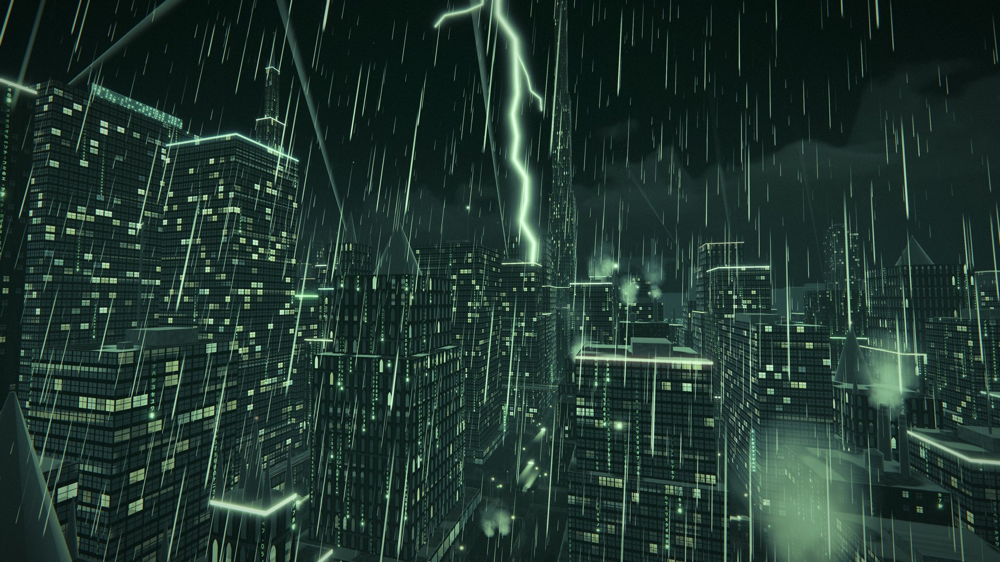
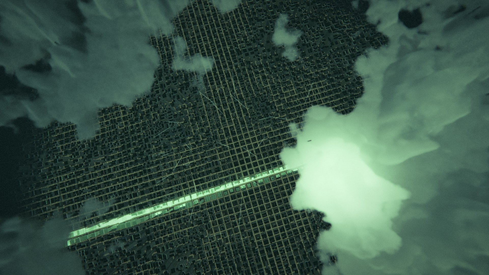
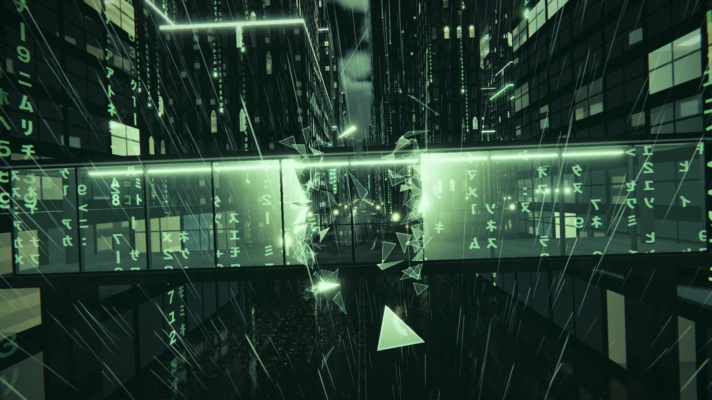

<h1 align="center">Matrix Vibe</h1>

<h3 align="center">An endless night city in the rain. You fly through it.</h3>

<p align="center">
  
</p>

Matrix Vibe is a 3D world that runs in the browser. The city, the clouds, the weather and the traffic are generated while you fly. Every sound is a recording, and the stars are the real sky.

**[Fly it now](https://matrix-vibe.whoopscope.workers.dev)**

## Written by a model

This project is an experiment. It exists to test and measure one AI model: Claude Fable 5.2, in Claude Code. A person gave directions in plain language. The model wrote the code, the shaders, the films and the documents, and it checked its own pictures frame by frame.

[How it was written, and what went wrong](docs/experiment.md)

<p align="center">
  
</p>

## Three films inside

Each film is a scripted camera path with timed events. It plays live, in the same world: [the film](https://matrix-vibe.whoopscope.workers.dev/?tour=film), [the reel](https://matrix-vibe.whoopscope.workers.dev/?tour=reel) and [one night that repeats](https://matrix-vibe.whoopscope.workers.dev/?tour=loop). A click starts it.

<p align="center">
  
</p>

## Fly

- `W` `A` `S` `D` and the mouse fly. `Shift` boosts, and `Space` launches upward.
- `F` slows time. `G` recompiles the city. `R` makes a new city.
- `C` gives the controls back to the cinematic flight.

All keys are in [docs/flight.md](docs/flight.md).

## Run it

```sh
npm install
npm run dev
```

`npm run build` writes a static site to `dist/`, and `npm run deploy` puts it on Cloudflare.
The code is plain JavaScript modules with Vite and Three.js. It has no server code, and it needs a browser with WebGL2.

## Documents

[The experiment](docs/experiment.md) · [Architecture](docs/architecture.md) · [World](docs/world.md) · [Rendering](docs/rendering.md) · [Sky and clouds](docs/sky-and-clouds.md) · [Flight](docs/flight.md) · [Audio](docs/audio.md) · [Tours](docs/tours.md) · [Recording](docs/recording.md) · [Assets and licences](docs/assets.md)
